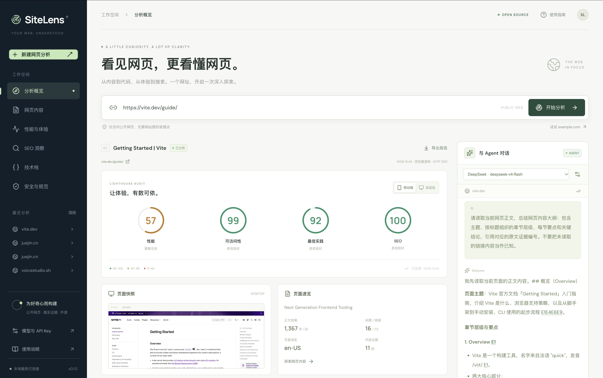
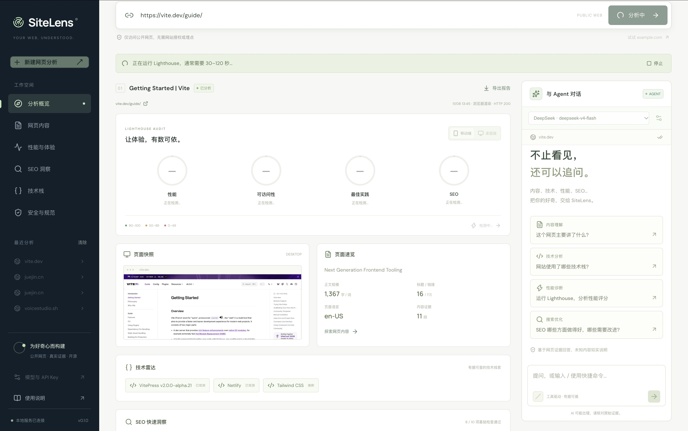
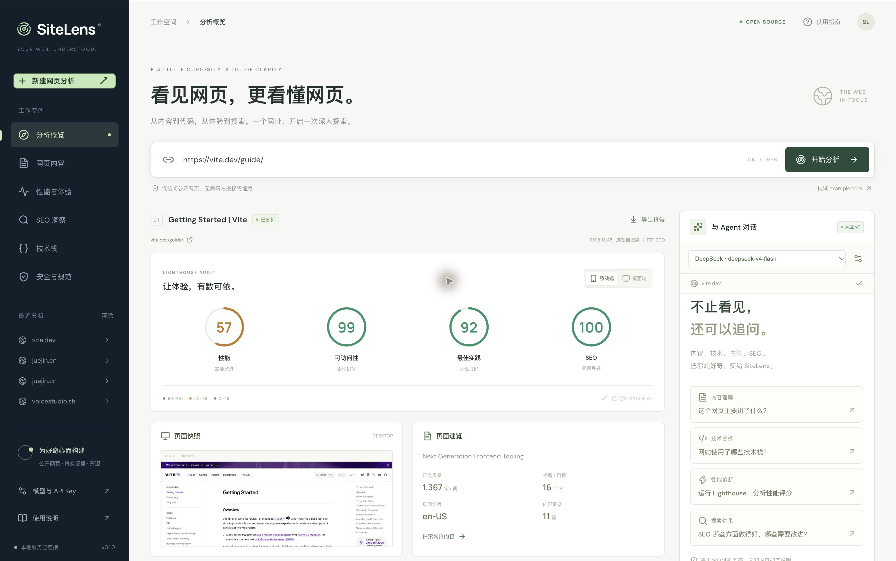
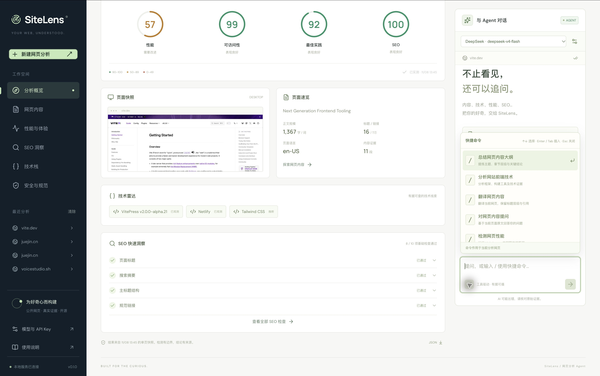
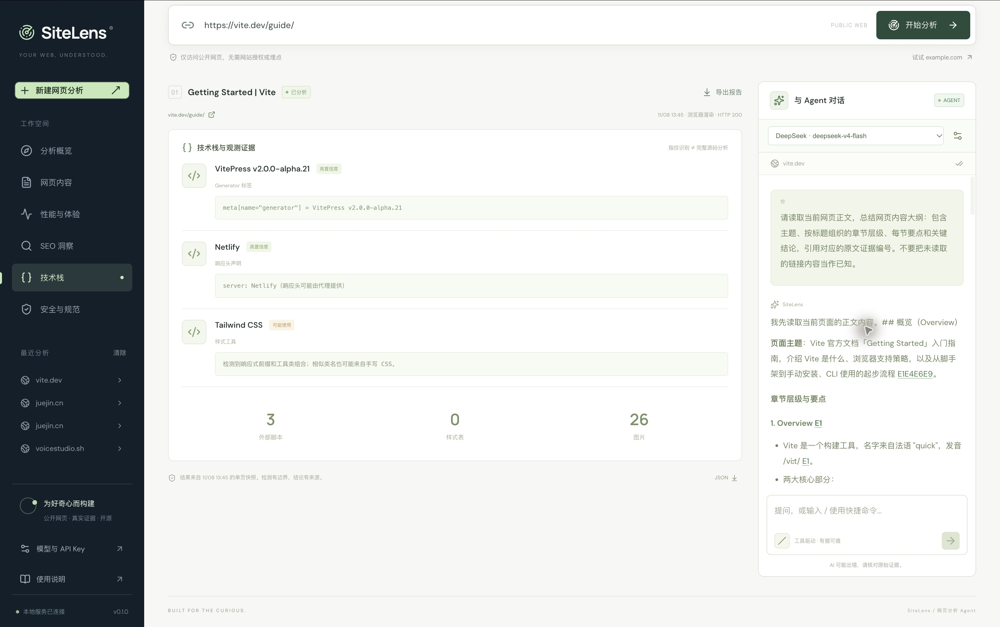
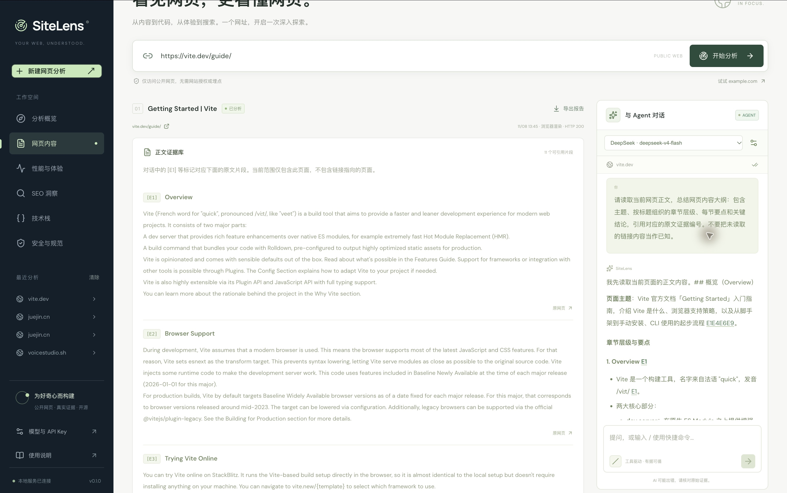
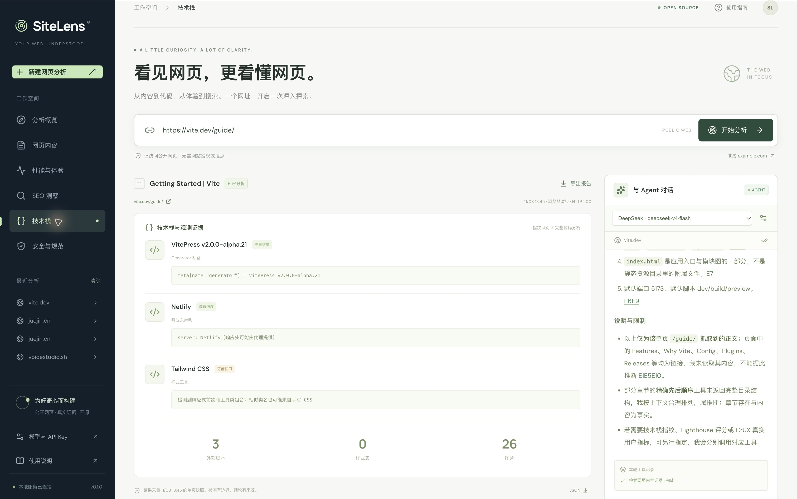
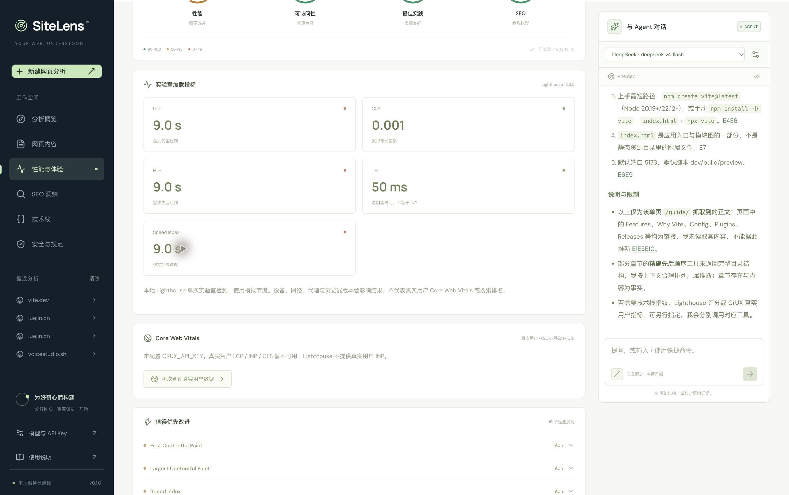
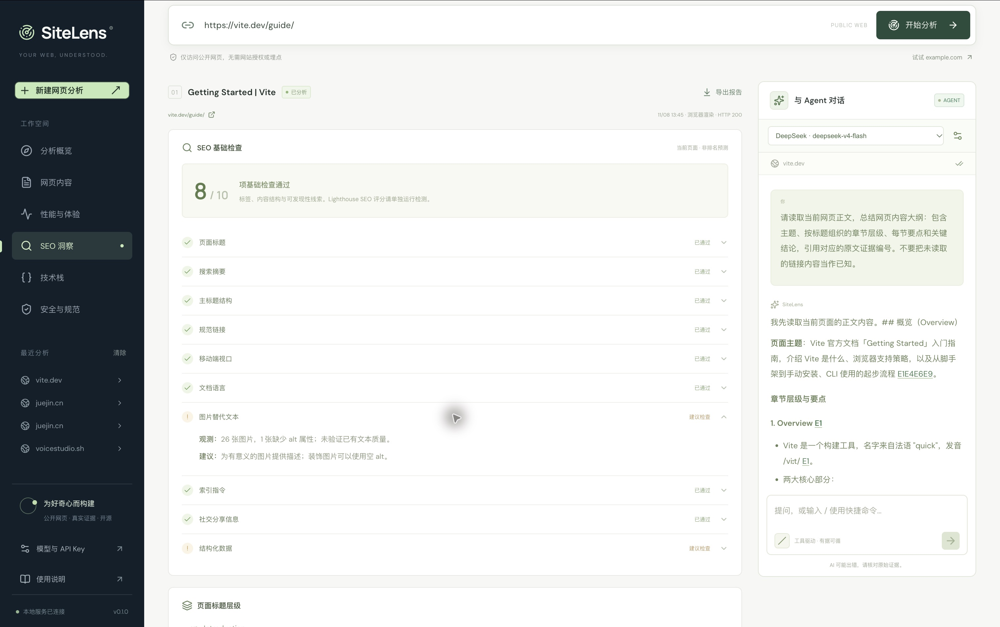

<div align="center">

# page scout agent

### 把一个网址，变成一场有依据的对话。

阅读网页 · 解读技术 · 实测性能 · 发现 SEO 优化机会

**开源 / 自带模型 Key / 工具驱动 / 原文可追溯**

[开始体验](#get-started) · [看一次真实分析](#walkthrough) · [快捷命令](#slash-commands) · [开发与部署](docs/development.md) · [架构说明](docs/architecture.md)

</div>



你打开一个网站，可能想知道：这篇长文讲了什么？它用了哪些前端技术？手机端为什么加载慢？SEO 哪些地方值得学习？

**page scout agent 把这些问题放进同一个工作台。** 输入公开网址，左侧查看真实页面、检测结果和证据，右侧直接追问 Agent。回答中的引用可以点回正文；性能分数来自实际运行的 Lighthouse；技术判断会说明依据与置信度。

这份 README 按一次真实使用流程编写：我们在本地输入 `https://vite.dev/guide/`，完成分析、快捷总结、引用跳转、SEO 检查、CrUX 查询和报告导出。下面的图片都是 **2026-11-08 的实际界面截图**，没有填入演示分数或模拟模型回答。

## 你可以用它做什么？

| 你想解决的问题           | 在 page scout agent 中怎么做             | 你得到什么                                          |
| ------------------------ | ---------------------------------------- | --------------------------------------------------- |
| 长文太长，先抓住重点     | `/总结网页内容大纲`                      | 主题、章节要点、关键结论与原文引用                  |
| 看到一个网站，想研究实现 | `/分析网站前端技术` 或进入「技术栈」     | 可观测指纹、资源线索、置信度与无法确认的部分        |
| 想知道页面哪里慢         | 自动 Lighthouse / `/检测网页性能`        | 四项评分、加载指标、待改进项目、原始报告            |
| 不知道 SEO 从哪里检查    | `/分析网页SEO` 或进入「SEO 洞察」        | 做得好的项目、待检查项、证据与改进建议              |
| 阅读外语资料             | `/翻译网页内容 中文`                     | 按指定语言翻译，保留结构；长内容需注明覆盖范围      |
| 对页面某一点有疑问       | `/对网页内容提问 这个工具如何开始使用？` | 基于当前页面证据的回答，支持继续追问                |
| 想把发现带走             | 点击「导出报告」                         | Markdown 汇总，另可下载 JSON 和原始 Lighthouse 报告 |

适合前端开发者研究公开网站、开源作者检查项目官网、独立开发者查找优化方向，也适合想边读文档边提问的人。

<a id="get-started"></a>

## 先花几分钟，把它跑起来

需要 **Node.js 22.19+**，推荐 Node.js 24 LTS，以及 Chrome / Chromium。

在仓库根目录运行：

```bash
npm ci
npm run browser:install
npm run dev
```

打开 **http://127.0.0.1:3000**。本机已安装 Chrome 时通常可以省略浏览器下载；Linux 系统依赖、自定义浏览器路径和生产运行方法见[开发手册](docs/development.md)。

**先不填模型 Key，也能体验网页抓取和真实检测。** 要使用模型总结、翻译与多轮对话，打开「模型与 API Key」，选择服务商并保存自己的 Key。无需修改代码或重启。

| 想使用的模型服务 | 配置方式                                                        |
| ---------------- | --------------------------------------------------------------- |
| DeepSeek         | 预设包含 V4 Flash、V4 Pro 和 Flash 标识                         |
| Kimi / Moonshot  | 选择预设，或填写账号有权限的模型标识                            |
| OpenAI           | 选择预设，或填写支持工具调用的模型标识                          |
| 智普 / GLM       | 选择 GLM 预设，或填写自己的模型标识                             |
| 其他兼容服务     | 选择「自定义兼容接口」，填写公开 HTTPS Base URL、模型标识和 Key |

模型是否可用取决于服务商、账号权限、区域与余额。可以先点 **「测试连接」**，它会发送一次少量 Token 的流式工具调用。普通 API、国际区和 Coding Plan 的接口与 Key 应分别匹配，详见[模型配置说明](docs/development.md#在网页设置模型与-key)。

Key 可以选择「在此浏览器记住」，也可以只在当前页面内存使用。持久保存使用**未加密的浏览器本地存储**，共享设备使用后请删除 Key。请求经本站后端转发到所选模型服务；Key 不写入报告，也不会发送给被分析的网站。模型调用可能按服务商计费。

<a id="walkthrough"></a>

## 一次真实体验：从 Vite 文档开始

### 1. 粘贴网址，等页面变成证据

本次输入的是：

```text
https://vite.dev/guide/
```

点击「开始分析」后，界面会显示公开地址验证、浏览器渲染、正文提取和 Lighthouse 检测的进度。抓取完成后会自动运行当前所选设备的评分，通常需要 **30–120 秒**。过程中可以停止；失败时会显示原因，并保留已抓取的页面供继续阅读。



这次分析得到页面标题 **Getting Started | Vite**、英文正文、**11 段内容证据、16 个标题和 113 个链接**。左侧的页面快照帮助确认：分析的是你输入的那个页面。

### 2. 用一屏结果，决定下一步看哪里



这次移动端实测使用 Lighthouse **13.6.0**：

| 检测维度 | 本次结果 |
| -------- | -------: |
| 性能     |       57 |
| 可访问性 |       99 |
| 最佳实践 |       92 |
| SEO      |      100 |

这些数字是**本机当时条件下的单次实验室结果**，会受到设备、网络、代理、浏览器版本与页面变化影响，不能当作 Vite 的永久评分，也不能直接代表真实用户体验。

概览告诉我们：本次更值得先查看加载性能，而不是仅凭某个绿色分数就停止检查。进入「性能与体验」，可以继续看具体指标和改进项目。

### 3. 输入 `/`，不用从零组织问题

点击右侧输入框下方的 `/` 按钮，或直接输入 `/`，就能打开快捷菜单。菜单提供任务名称与用途说明，可以继续输入中文筛选。



本次选择了 **`/总结网页内容大纲`**。选中只会把命令插入输入框，再按一次 Enter 才发送，方便在执行前确认。

| 操作                | 快捷键        |
| ------------------- | ------------- |
| 选择上一项 / 下一项 | ↑ / ↓         |
| 插入选中的命令      | Enter / Tab   |
| 关闭菜单            | Esc           |
| 输入换行            | Shift + Enter |

翻译命令需要目标语言，提问命令需要问题；缺少参数时会保留草稿并提示补充。网页命令需要先建立当前页面的分析快照。

### 4. 读总结，也能核对总结

这次右侧使用已配置的 **DeepSeek · deepseek-v4-flash**。提交总结后，Agent 实际调用了正文检索工具，生成了 Vite 入门指南的主题、章节层级、要点和关键结论，并附上 `[E1]`、`[E4]` 等引用。



点击回答中的引用，左侧会跳转到「网页内容」中的对应原文。这次点击 `[E1]`，看到的正是 Overview 片段；无需在模型回答和原网页之间反复猜测出处。



**引用让回答可以检查，不代表回答永远正确。** 本次模型还主动指出了单页范围和部分章节排序的推断。重要信息仍应与原文核对，页面中的链接也不等于已被 Agent 读取。

### 5. 研究技术栈，要看证据和置信度

进入「技术栈」，本次界面展示了三条线索：

| 线索                      | 页面给出的依据         | 怎么理解                               |
| ------------------------- | ---------------------- | -------------------------------------- |
| VitePress v2.0.0-alpha.21 | Generator 元标签       | 直接观察到页面的构建声明               |
| Netlify                   | `server` 响应头        | 响应链路中的服务声明，可能来自代理     |
| Tailwind CSS              | 响应式前缀与工具类组合 | 启发式推断，相似类名也可能来自手写样式 |



这里最有价值的不是“猜中了多少技术”，而是能区分**已经看到什么、可能是什么、还无法确认什么**。前端指纹不能证明后端框架、数据库或完整源码实现。

### 6. 从分数走向具体优化项

本次「性能与体验」面板实际显示：

| 实验室指标  | 本次值 | 阅读方式                           |
| ----------- | -----: | ---------------------------------- |
| LCP         |  9.0 s | 最大内容绘制，本次加载链路值得检查 |
| CLS         |  0.001 | 本次加载时布局较稳定               |
| FCP         |  9.0 s | 首次内容出现较晚                   |
| TBT         |  50 ms | 总阻塞时间，**不等于 INP**         |
| Speed Index |  9.0 s | 本次视觉加载速度                   |

界面还列出了缓存时效、字体显示、阻塞渲染资源、未使用 CSS / JavaScript 等待检查项目。它们是进一步定位的入口，不应在未看具体资源前就一概修改。



这次也点击了「查询真实用户指标」。由于运行环境未配置 `CRUX_API_KEY`，界面明确提示真实用户 LCP / INP / CLS 暂不可用，**没有用实验室数字填补空缺**。

如果你配置了 CrUX，结果会标注移动端 p75、统计窗口和 URL / 整个来源范围。Lighthouse 与 CrUX 是两类来源；本次没有拿到真实用户数据，因此不能据此判断该页面是否通过真实用户 Core Web Vitals。

### 7. SEO 高分，也可以继续找改进空间

本次 Lighthouse SEO 为 **100**，而基础 SEO 检查是 **8 / 10 项通过**。两者检查规则与范围不同，可以同时成立。



本次展开「图片替代文本」后，看到 **26 张图片中有 1 张缺少 alt 属性**，并给出区分有意义图片与装饰图片的建议；另一个建议检查项是结构化数据。

这些结果帮助你从“这个页面 SEO 好不好”继续追问到“具体需要检查什么”。没有 JSON-LD 不代表每种页面都必须补，SEO 通过数也不保证搜索排名或收录。

### 8. 导出，把发现变成可分享的资料

本次实际点击了「导出报告」，浏览器成功下载 `sitelens-vite.dev.md`。导出包含页面信息、技术线索、SEO 与安全头检查、已完成的 Lighthouse 结果和正文证据。

仓库附上了这次导出的[检测结果节选](docs/examples/vite-guide-audit.md)，省略正文证据章节，便于快速阅读。性能页还提供完整 Lighthouse HTML 和原始 JSON 下载；概览底部的 JSON 按钮可以导出当前分析快照。

<a id="slash-commands"></a>

## 可以直接复制的快捷命令

```text
/总结网页内容大纲
/分析网站前端技术
/翻译网页内容 中文
/对网页内容提问 这篇文档给出的最短上手路径是什么？
/检测网页性能
/分析网页SEO
```

也可以直接说：

```text
请只回答页面中明确提到的内容，并附原文引用。
哪些技术是直接观测到的？哪些只是推断？
结合当前 Lighthouse 结果，列出三个最值得先检查的问题。
把刚才的建议整理成一个待办清单。
```

总结、翻译和网页问答需要配置模型。长页面翻译受到正文提取范围、检索上下文和模型输出长度限制，可以按章节分批请求，并确认本次覆盖范围。

## 哪些能力不需要模型 Key？

| 能力                           | 未配置模型               | 已配置模型                   |
| ------------------------------ | ------------------------ | ---------------------------- |
| 抓取、渲染、截图、正文证据     | 可用                     | 可用                         |
| 技术指纹、SEO、安全头面板      | 可用                     | 可用                         |
| 真实 Lighthouse 与报告导出     | 可用                     | 可用                         |
| 右侧免密钥证据检索             | 可用，明确标注为证据模式 | 可由 Agent 按需使用          |
| 自由对话、总结、翻译、多轮推理 | 需配置模型               | 可用，依赖所选模型能力       |
| CrUX 真实用户数据              | 另需 CrUX Key 与足够样本 | 同样另需 CrUX Key 与足够样本 |

本次实际验证了 DeepSeek 总结，未逐一实测所有模型、所有翻译语言或桌面端评分。多服务商入口已提供，具体账号可用性请通过自己的 Key 验证。

## 遇到问题，先看这里

| 现象                     | 可以怎么处理                                                             |
| ------------------------ | ------------------------------------------------------------------------ |
| 评分暂时是横线           | 看顶部是否仍在抓取或检测；首次 Lighthouse 通常需要 30–120 秒             |
| 检测失败或被停止         | 阅读错误原因，保留网页内容继续查看，再点击重试                           |
| 页面只有导航或少量文本   | 可能依赖登录、动态请求或防抓取；优先尝试公开文章详情页，核对正文证据数量 |
| Agent 仍显示证据模式     | 打开模型设置保存 Key，检查右侧选中的服务商                               |
| 模型认证、限流或额度错误 | 核对模型权限、Key 区域、Base URL、余额与配额                             |
| CrUX 没有数据            | 检查 Key 和 API 启用情况；有些页面没有足够真实用户样本                   |
| 想重新测量同一网页       | 重新点击「开始分析」生成新快照；同一快照同一设备会复用已完成评分         |
| 快照过期                 | 重新分析 URL；默认快照在内存中，重启或闲置约一小时后失效                 |

## 使用前，了解它的范围

当前版本面向**公开、无需登录的单页网页**。不提供全站爬取、登录态分析、验证码绕过、完整人工无障碍审计或漏洞扫描。安全头检查仅说明响应头声明，不能据此认证网站安全。

桌面截图与移动端 / 桌面端评分是独立的；切换评分设备不会把已有页面快照变成手机截图。默认不持久保存正文、截图或对话；浏览器会记住最近的网址，以及你选择保存的模型配置。

本站会将按需检索的页面片段与检测结果发送给你选择的模型服务。公开部署应使用 HTTPS、鉴权、用户配额和隔离的浏览器检测环境。当前默认是本机服务，详细部署边界见[开发手册](docs/development.md#部署)。

## 给开发者

前端使用 React、TypeScript 和 Vite；后端使用 Express、AI SDK、Playwright、Lighthouse 和 Cheerio。Agent 按需调用工具，前后端通过流式事件同步正文、执行记录和报告。

```bash
npm run typecheck
npm test
npm run build
npm run format:check
```

- [开发、配置与部署手册](docs/development.md)
- [架构、设计取舍与面试讲解点](docs/architecture.md)
- [这次真实导出的检测结果节选](docs/examples/vite-guide-audit.md)
- [截图与体验记录](docs/images/README.md)
- [参与贡献](CONTRIBUTING.md)

## License

page scout agent 使用 [MIT License](LICENSE)。截图中的 Vite 页面内容与品牌归各自权利人所有；本文用于展示一次真实的公开网页分析流程，不表示获得 Vite 官方背书。
