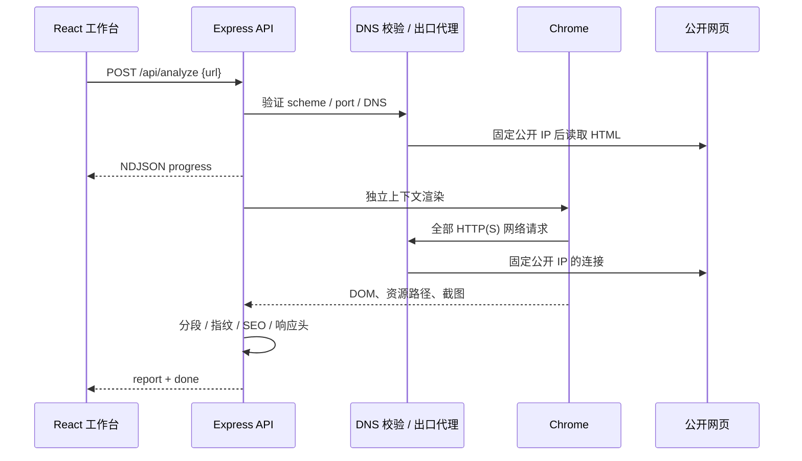
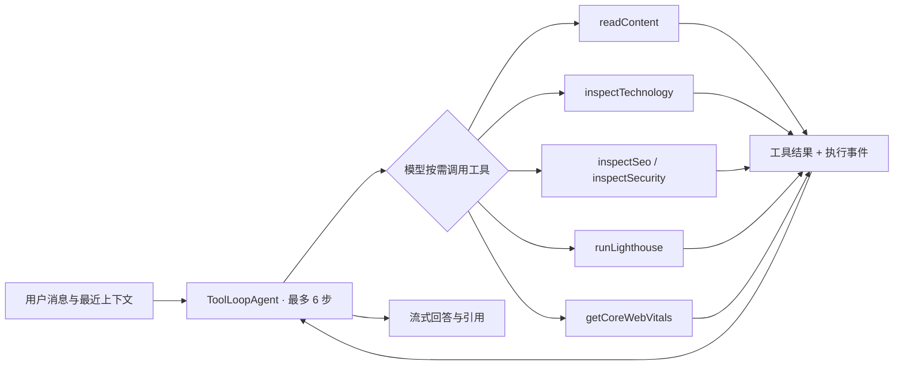

# SiteLens 架构与设计取舍

## 一次分析

正文分段以标题为边界，为每段生成稳定于该快照内的 `[E1]` 等引用。单页内容检索采用中英文关键词评分，不引入向量数据库。这个范围下可解释性、启动成本和可测试性更重要；复杂中文语义与跨语言检索效果有限，LLM 只对实际取出的证据作答。

HTML 请求与浏览器都需要公共网络边界。服务端请求把校验后的 DNS 结果固定到 socket；浏览器通过逐连接校验的 HTTP CONNECT 代理出网，TLS 仍由 Chrome 与目标站点端到端协商。代理不解密 HTTPS，也不把所有资源转成抓取后的替代内容。

## 一次对话

前端通过同一个 NDJSON 协议接收 progress、tool、report、text、error、done。客户端不需要理解各家模型的原始流格式。所有模型凭据留在服务端，工具没有执行任意 JS、任意 shell 或读取文件的能力。

没有配置模型时使用明确标注的证据模式，它不是另一种隐式 Agent。模型 SDK 的工具循环由集成测试中的兼容协议夹具验证，模型回答质量需要配置真实服务后单独评估。

## 两种性能数据

| 数据       | 来源                        | 表示什么                                    | 不能推出什么                           |
| ---------- | --------------------------- | ------------------------------------------- | -------------------------------------- |
| Lighthouse | 本地 Chrome，单次实验室检测 | 当前条件下的性能与自动检查                  | 真实用户 INP、全站体验、搜索排名       |
| CrUX       | Google 汇总的真实用户数据   | 指定窗口与范围内，PHONE p75 LCP / INP / CLS | 无样本页面的体验、刚部署版本的即时效果 |

两个来源有独立的数据结构与界面区域。CrUX URL 无数据时才回退 origin，范围会随结果返回。无数据保持无数据，绝不由实验室值补齐。

## 任务与生命周期

- 每个快照同时只运行一个对话或检测，避免模型与按钮重复触发同一任务。
- 浏览器渲染最多并发 2 个，Lighthouse 全进程并发 1 个。
- Lighthouse 同一快照、同一设备缓存结果；重新分析获得新快照。
- 断开客户端会触发 AbortSignal；流式模型请求、HTML 请求和浏览器进程会清理。
- 报告默认最多 25 个、闲置约 1 小时过期；原始 Lighthouse HTML / JSON 与快照同步清理。

## 面试可讲的设计问题

1. 为什么工具数据有出处和置信度，回答需要引用？如何识别“技术推断”与“直接观测”？
2. 为什么不能把 SEO 基础检查、Lighthouse SEO 和搜索排名混为一谈？
3. 为什么 LCP / CLS 实验室数据不能用于补齐真实用户 CWV，TBT 不能替代 INP？
4. 为什么只验证输入 URL 不足以防 SSRF？重定向、子资源与 DNS 二次解析各有什么影响？
5. 为什么单页第一版选关键词检索，而不立即加向量库？何时值得换成混合检索？
6. 为什么本地原型采用内存快照，公开服务却需要用户隔离、队列和 worker？
7. 如何验证 SDK 真正执行并反馈工具，而不是只测 prompt 文案？

## 后续适合扩展

- 持久化报告、不同时间快照对比、性能回归。
- URL 级独立 worker、队列、按用户配额与鉴权。
- 在用户明确选定范围后进行站内多页分析、robots 规则和站点地图检查。
- 链接检测、语义结构检查、axe 与人工检查协作。
- 带标注截图、首屏元素与 Lighthouse 审计项目的证据映射。
- 固定评测集：正确工具选择率、引用准确率、事实支持率、失败与取消处理、成本和耗时。

不把后续路线写成当前已实现的能力。
